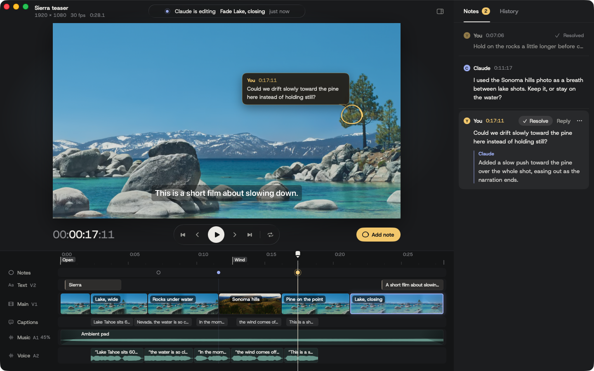

# Cutline

A macOS video editor that Claude drives through MCP. You don't edit: you watch the preview, scrub, and pin notes on frames. Claude reads the notes and changes the edit.

- **Agent-native editing**: 58 MCP tools cover what Premiere or Final Cut can do: effects, color grading, transitions, speed ramps, masks, keying, nesting, multicam, motion graphics, pro audio finishing and delivery.
- **The agent can see and hear**: on-device transcripts with speakers and emphasis, beats, shot descriptions, faces, sound events, and rendered frames. Picture, loudness and legibility come back as numbers.
- **Same pixels everywhere**: the preview and the export both use one Metal compositor built on AVFoundation.
- **Notes on frames**: press C in the preview, click the spot, and type. Claude replies in the same thread.
- **Every edit is undoable**: each tool call is a history entry, and `batch` groups several.



Requires macOS 26 on Apple Silicon.

## Install

Download `Cutline.dmg`, drag Cutline to Applications, then connect it to Claude Code:

```sh
claude mcp add cutline -- /Applications/Cutline.app/Contents/MacOS/cutline-mcp
```

Then ask Claude for a video:

> Make a 45-second vertical cut of ~/Movies/interview.mov with bold captions, no pauses, and the logo in the corner.

Claude creates a `.cutline` project and opens it in the preview window.

## What Claude can do

| Area | Tools |
| --- | --- |
| Project | `project_create`, `project_open`, `project_status` (whole project, or every parameter of one clip), `canvas_set`, `history` (list, undo, redo, restore, diff, fork), `timelines` (several timelines per project), `timeline_import` (FCPXML, OTIO, EDL, FCP7 XML or AAF as a new timeline), `project_patch` (JSON Patch, last resort) |
| Media and perception | `media_import`, `media_relink` (offline media from a folder by file name or reel and timecode), `media_list` (bins, metadata, usage), `media_organize` (bins, metadata, log, field order), `media_analyze` (transcript, scenes, beats, speakers, shots, sounds; background jobs), `analysis_read`, `media_transcript` (word ids, speakers, stressed words), `transcript_edit` (fix words and speakers), `media_frames` (face and subject overlays), `media_track` (follow an object), `media_remove` |
| Structure | `assemble` (word handles), `cut_silences` (pauses from speech or level), `source_cut`, `range_delete`, `clip_add` (media, color, adjustment layer, generated graphics), `text_add` (per-word animation), `clip_update`, `clip_split`, `clip_delete`, `trim` (ripple, roll, slip, slide, J/L), `sequence_nest`, `multicam_create` (synced angles in one multicam clip), `multicam_cut` (switch the live angle at a time or for a range), `multicam_angles`, `track_add`, `track_update`, `markers` |
| Look and sound | `param_set` (set, animate or bind any parameter), `effect_add` (video, color, mask, key and audio effects on clips, tracks, adjustment layers and the master; lens distortion, chromatic aberration, vignette and rolling shutter repair), `audio_bus` (submix buses with effects, fader automation, mute/solo and sends; DME stems), `voiceover_record` (record voice-over or ADR takes in the preview app), `transition_set`, `captions_set`, `captions_list`, `caption_edit` (rewrite, retime, hide, split or join cues), `captions_translate` (subtitles in several languages at once, on-device or supplied) |
| Reuse | `catalog`, `recipe` (duck, loudness, J/L cuts, speed ramps, freeze frames, punch-ins, PiP, split screens, reframing, beat cuts, looks, glitches, whip pans, kinetic text, multicam, follow, tracked roto, templates), `template_save` (templates shared as files), `batch` |
| Review | `timeline_frames` (multicam:true shows every angle side by side), `timeline_transcript`, `timeline_measure` (loudness, true peak, exposure, color cast, flashes, text contrast, safe areas), `comments_list`, `comment_reply`, `comment_add`, `preview_seek`, `preview_state` |
| Output | `export` (HEVC, H.264, ProRes 422 HQ/LT/Proxy and 4444/XQ, DNxHR and XDCAM with ffmpeg; QuickTime timecode track, bars, tone, slate and 2-pop leader; platform checks including EBU R128 and ATSC A/85 broadcast, embedded subtitles and chapters, SRT/VTT/TTML, OTIO, FCPXML, EDL, FCP7 XML, AAF with linked media and handles for Pro Tools/Media Composer, stems, the base version plus variants per call) |

Every parameter has a path, such as `transform.scale`, `audio.volume`, `text.color` or `fx.blur1.radius`, and any number or color can be animated with eased keyframes. Times can be anchors that survive later edits, such as a transcript word (`interview.w42`), a beat (`music.b16`, `beat:16`), a shot (`broll.s3`), a clip edge (`clip_ab12cd.end-0.5`) or a marker (`marker:Intro`). Every edit takes `dry_run` to preview its changes.

## Project format

A project is a `.cutline` folder of plain JSON:

```
project.json    canvas, media, tracks, clips, captions, markers
history.json    edit history; snapshots in history/
comments.json   notes from the preview and replies from Claude
analysis/       transcripts, audio levels, scenes, beats, speakers, shots, faces, sounds per media file
cache/          rendered audio stems
exports/        rendered videos
```

Media is referenced in place, not copied.

## Preview controls

| Key | Action |
| --- | --- |
| Space | Play or pause |
| ← → | Step one frame (with Shift, one second) |
| J K L | Shuttle back, stop, forward |
| C | Pin a note to the current frame |
| Home, End | Go to start or end |
| ⌘-scroll, pinch | Zoom the timeline |

## Develop

```sh
swift build -c release --arch arm64   # app and MCP server
swift test                            # core editing tests
scripts/make-fixtures.sh              # sample media (needs ffmpeg)
scripts/build-app.sh                  # dist/Cutline.app
scripts/create-dmg.sh                 # dist/Cutline.dmg
```

The repo's `.mcp.json` points Claude Code at the development build, so opening Claude Code in this folder gives you the tools right away. `scripts/mcp-session.py` drives the server from a JSON list of tool calls and saves returned images.

| Target | Role |
| --- | --- |
| `CutlineCore` | Model, edits, captions, history, bundle IO |
| `CutlineEngine` | AVFoundation composition, Metal compositor, text, analysis, export |
| `CutlineMCP`, `cutline-mcp` | MCP server over stdio |
| `Cutline` | SwiftUI preview app |

## Design

Wax yellow marks your notes and periwinkle marks everything Claude does: note pins, replies, the live status dot and the outline on a clip Claude just changed. The interface is set in [Host Grotesk](https://github.com/HostGrotesk/Host-Grotesk) (SIL Open Font License, bundled in `Sources/Cutline/Fonts`).

## License

MIT
